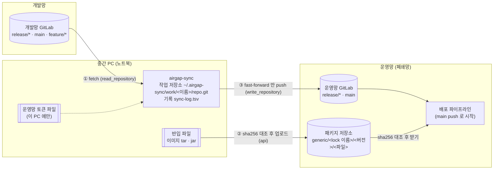

# airgap-sync — 망분리 GitLab 브랜치 미러 + 바이너리 반입

[English](README.md)

개발망 GitLab의 **릴리즈 브랜치만** 운영망 GitLab으로 넘기는 도구입니다. 두 망을 잇는 것은 중간 PC(노트북) 한 대뿐이라는 전제로 만들었습니다.

- 지정한 브랜치 패턴(기본 `release/*`, `main`)만 넣습니다. 다른 브랜치·태그·삭제는 옮기지 않습니다.
- 운영망 브랜치가 fast-forward가 아니면 **아무것도 넣지 않고 멈춥니다.** `--force`를 줬을 때만 덮어쓰고, 이때도 lease로 보호합니다.
- 결과를 기록합니다: 브랜치별 이전 SHA → 새 SHA, 시각, 대상.
- `--dry-run`으로 무엇을 넣을지 미리 볼 수 있습니다.
- lock 파일에 적힌 이미지·바이너리를 운영망 패키지 저장소에 올리는 단계를 같은 흐름에 선택 항목으로 넣을 수 있습니다. 파일마다 sha256을 대조하고, 이미 올라가 있으면 건너뜁니다.

주소·호스트명·토큰 같은 실제 값은 저장소에 두지 않고, 중간 PC의 설정 파일(`~/.airgap-sync/*.conf`)과 토큰 파일에만 둡니다. 화면 출력과 기록은 한국어입니다.

| 파일 | 내용 |
|---|---|
| `airgap-sync.sh` | 본체(bash 4+). Linux·macOS·Git Bash |
| `airgap-sync.ps1` | Windows PowerShell 5.1+/7 래퍼. Git for Windows의 bash로 본체를 실행합니다(로직은 한 벌) |
| `airgap-sync.example.conf` | 설정 예시 |
| `ci/gitlab-ci.example.yml` | 개발망 저장소에 붙일 CI 잡 (방식 a) |
| `runner/docker-compose.example.yml` | 중간 PC 에서 항시 도는 러너 컨테이너 예시 |
| `test/e2e-local-gitlab.sh` | 로컬 GitLab 두 프로젝트로 (a)·(b)를 끝까지 돌리는 시험 |

## 1. 구조



```
 방식 (a) 두 망에 동시에 붙는 경우 — 한 번에
   개발망 GitLab ──fetch──▶ [중간 PC: mirror / CI 잡 ci] ──packages──▶ 운영망 패키지 저장소
                                                       └──push─────▶ 운영망 GitLab

 방식 (b) 망을 바꿔 가며 붙는 경우 — 2단계
   [개발망에 연결]  개발망 GitLab ──fetch──▶ bundle-create ──▶ x.bundle + x.bundle.sha256 + x.bundle.manifest
   ─────────────── 망 전환 (같은 PC, 또는 bundle 을 매체로 옮김) ───────────────
   [운영망에 연결]  bundle-push x.bundle --sha256 <기록해 둔 값>
                    sha256 대조 → git bundle verify → manifest 대조 → fast-forward 확인 → packages → push
```

순서에서 지키는 것:

1. fast-forward 판정을 먼저 합니다. 멈출 실행에서는 파일도 올리지 않습니다.
2. 패키지를 브랜치보다 먼저 올립니다. `main` push가 배포 파이프라인을 깨우고, 그 파이프라인이 패키지를 받기 때문입니다. 패키지 단계가 실패하면 브랜치도 넣지 않습니다.
3. 여러 브랜치는 `git push --atomic`으로 한꺼번에 넣습니다. 전부 들어가거나 하나도 안 들어갑니다.

## 2. 토큰과 권한

| 어디 | 토큰 | 권한(scope) | 역할 | 어디에 두나 |
|---|---|---|---|---|
| 개발망 GitLab | 프로젝트 토큰 또는 PAT. SSH 키로 대신할 수 있습니다 | `read_repository` (Reporter 이상) | fetch | 중간 PC. CI 잡에서는 job token을 자동으로 씁니다 |
| 운영망 GitLab | 프로젝트 토큰 또는 PAT | `write_repository` + `api` (Maintainer: 보호된 `main`에 push. 패키지만 올리면 Developer) | push, 패키지 조회·업로드 | **중간 PC에만** 두는 파일(`TARGET_TOKEN_FILE`, 권한 600) |

- 운영망 토큰은 저장소에도, 개발망 GitLab의 CI 변수에도 넣지 않습니다. 개발망 GitLab에 넣으면 그 서버 관리자와 잡을 고칠 수 있는 사람이 모두 운영망 쓰기 권한을 얻습니다.
- 도구는 토큰을 명령줄로 넘기지 않습니다. git에는 `GIT_CONFIG_*` 환경 변수의 인증 헤더로, curl에는 stdin 설정(`-K -`)으로 넘깁니다. 그래서 프로세스 목록과 CI 로그에 토큰이 남지 않습니다. 기록 파일과 화면에 찍는 URL에서는 사용자·비밀번호 부분을 지웁니다.
- `--force`가 보호 브랜치(`main`)에서 거부되는 것은 정상입니다. 운영망의 Protected branches에서 force push를 허용하지 않는 한 덮어쓸 수 없습니다.
- 프로젝트 토큰은 만료일이 있습니다. 만료되면 401이 납니다(9절).

## 3. 처음 설정

### 3.1 공통 (중간 PC)

1. git 2.31 이상을 설치합니다(Windows는 Git for Windows). curl도 필요합니다.
2. 설정 파일을 만듭니다.

   ```bash
   mkdir -p ~/.airgap-sync && chmod 700 ~/.airgap-sync
   cp ./airgap-sync.example.conf ~/.airgap-sync/airgap-sync.conf   # 값 채우기
   printf '%s' '<운영망 토큰>' > ~/.airgap-sync/target.token && chmod 600 ~/.airgap-sync/target.token
   ```

   PowerShell에서는 이렇게 합니다.

   ```powershell
   New-Item -ItemType Directory -Force $HOME\.airgap-sync | Out-Null
   Copy-Item deploy\tools\airgap-sync\airgap-sync.example.conf $HOME\.airgap-sync\airgap-sync.conf
   $t = Read-Host '운영망 토큰' -AsSecureString
   [IO.File]::WriteAllText("$HOME\.airgap-sync\target.token", [Net.NetworkCredential]::new('', $t).Password)
   icacls "$HOME\.airgap-sync\target.token" /inheritance:r /grant:r "$($env:USERNAME):(R,W)" | Out-Null
   ```

3. 운영망 호스트 이름이 DNS로 풀리지 않으면 `TARGET_RESOLVE=<호스트>:<포트>:<IP>`를 넣습니다. git(`http.curloptResolve`)과 curl(`--resolve`)에만 적용되고, 시스템 hosts 파일이나 네트워크 설정은 건드리지 않습니다.
   운영망 연결이 간헐적으로 끊기면(TCP 연결이 15~20초 걸리다 `curl 28` 로 실패) 자동 재시도 설정(`TARGET_RETRIES`·`TARGET_RETRY_DELAY`)을 봅니다. 자세한 내용은 [운영망 연결 재시도](#운영망-연결-재시도)에 있습니다.
4. 확인합니다.

   ```bash
   ./airgap-sync.sh status
   ./airgap-sync.sh mirror --dry-run          # (a) — 두 망에 붙어 있을 때
   ./airgap-sync.sh bundle-create --dry-run   # (b) — 개발망에만 붙어 있을 때
   ```

   Windows에서는 `.\airgap-sync.ps1 status`처럼 같은 인자로 실행합니다.

설정 키는 `airgap-sync.example.conf`에 설명이 있습니다. 모든 키는 환경 변수 `AIRGAP_<키>`로 덮을 수 있고, 명령줄 옵션이 그보다 우선합니다. 설정 파일 위치는 `-c`가 먼저이고, 없으면 `$AIRGAP_CONFIG`, 그다음 `~/.airgap-sync/airgap-sync.conf` 순서로 찾습니다.

### 3.2 방식 (a) — CI 잡 (노트북의 GitLab Runner, shell executor)

1. 개발망 GitLab에서 프로젝트 Runner를 만듭니다: **Settings → CI/CD → Runners → New project runner**. 태그는 `airgap`, *Run untagged jobs*는 끕니다. 표시되는 `glrt-…` 토큰을 받아 둡니다.
2. 노트북에 gitlab-runner를 설치하고 등록합니다.

   ```powershell
   # Windows (관리자 PowerShell)
   gitlab-runner.exe install; gitlab-runner.exe start
   gitlab-runner.exe register --non-interactive --url https://<개발망 GitLab> --token glrt-… --executor shell --shell powershell
   ```

   ```bash
   # Linux·macOS
   sudo gitlab-runner register --non-interactive --url https://<개발망 GitLab> --token glrt-… --executor shell
   ```

   Docker 가 있으면 설치 대신 러너를 컨테이너로 항시 띄울 수 있습니다: [`runner/docker-compose.example.yml`](runner/docker-compose.example.yml) (`restart: unless-stopped`, shell executor, Docker 가 로그인·부팅 때 시작하도록 설정). 컨테이너가 두 GitLab 모두에 닿는지 먼저 확인합니다.

   잡은 Runner 서비스 계정의 HOME 아래 `~/.airgap-sync/airgap-sync.conf`를 읽습니다. 다른 위치를 쓰려면 `config.toml`의 `[[runners]]`에 `environment = ["AIRGAP_CONFIG=C:\\airgap\\app.conf"]`를 넣습니다. Windows 서비스(LocalSystem)로 돌린다면 서비스 계정을 노트북 사용자로 바꾸거나 `AIRGAP_CONFIG`로 위치를 지정합니다.
3. 프로젝트 CI/CD 변수(개발망)를 넣습니다. 둘 다 비밀값이 아닙니다.

   | 변수 | 값 | 뜻 |
   |---|---|---|
   | `AIRGAP_SYNC` | `powershell` 또는 `bash` | 이 변수가 있는 GitLab에서만 잡이 생깁니다. Runner의 shell에 맞춰 `airgap:sync:windows` 또는 `airgap:sync`가 생깁니다 |
   | `AIRGAP_SYNC_AUTO` | `1` (선택) | `main`·`release/*` push마다 자동으로 돕니다. 없으면 수동(▶) |

4. 개발망 저장소에 도구를 `tools/airgap-sync/`로 넣고(`airgap-sync.sh`·`airgap-sync.ps1`), [`ci/gitlab-ci.example.yml`](ci/gitlab-ci.example.yml)의 잡(`airgap:sync`, `airgap:sync:windows`)을 그 저장소 `.gitlab-ci.yml`에 붙입니다. 핵심 모양은 이렇습니다.

   ```yaml
   airgap:sync:
     stage: deploy
     tags: [airgap]
     resource_group: airgap-sync          # 동시에 하나만
     rules:
       - if: $AIRGAP_SYNC != "bash"
         when: never
       - if: ($CI_COMMIT_BRANCH == "main" || $CI_COMMIT_BRANCH =~ /^release\//) && $CI_PIPELINE_SOURCE == "push"
         when: manual
     script:
       - bash tools/airgap-sync/airgap-sync.sh ci          # PowerShell Runner: & .\tools\airgap-sync\airgap-sync.ps1 ci
     artifacts: { when: always, paths: [airgap-sync-report.tsv] }
   ```

   `ci` 명령은 push 파이프라인이면 그 브랜치만, 웹·스케줄 파이프라인이면 패턴 전체를 넣습니다. 설정에 `SOURCE_URL`이 없으면 잡의 저장소를 job token으로 읽습니다. 수동 실행할 때 `AIRGAP_DRY_RUN=1`, `AIRGAP_FORCE=1`, `AIRGAP_WITH_PACKAGES=1`을 변수로 줄 수 있습니다.
5. 처음에는 파이프라인을 수동 실행하면서 `AIRGAP_DRY_RUN=1`을 줘서 계획만 봅니다.

### 3.3 방식 (b) — bundle 수동 2단계

```bash
# 1) 개발망에 연결된 상태
./airgap-sync.sh bundle-create --with-packages
#    → ~/.airgap-sync/work/<이름>/bundles/<이름>-<시각>.bundle (+ .sha256, .manifest)
#    → 화면의 sha256 을 작업 기록에 따로 적어 둔다
#    → --with-packages: 반입할 파일이 이 PC 에 있고 lock 의 sha256 과 맞는지 망을 바꾸기 전에 확인

# 2) 망 전환 후 운영망에 연결된 상태
./airgap-sync.sh bundle-push ~/.airgap-sync/work/<이름>/bundles/<파일>.bundle \
    --sha256 <적어 둔 값> --with-packages
```

- bundle은 기본으로 **증분**입니다. 작업 저장소가 마지막으로 본 운영망 브랜치 이후의 커밋만 담습니다. 같은 PC로 두 단계를 하면 그대로 동작합니다. 다른 PC에서 2단계를 하거나 운영망 상태를 모르면 `--full`로 만듭니다. 증분으로 담을 수 없는 브랜치(되감긴 브랜치 등)가 있으면 알아서 전체 bundle로 다시 만듭니다.
- 2단계는 다음 중 하나라도 걸리면 거부하고(종료 4) 아무것도 넣지 않습니다.
  - 파일 sha256이 `--sha256` 값(없으면 `<bundle>.sha256`)과 다를 때
  - `git bundle verify`가 실패할 때
  - bundle 안 브랜치·SHA가 `.manifest`와 다를 때

  `.sha256` 파일은 bundle과 같이 다니므로 손상은 잡지만 바꿔치기는 막지 못합니다. 별도 경로로 적어 둔 값을 `--sha256`으로 주는 것이 원칙입니다.
- 2단계도 운영망 브랜치를 다시 읽어 fast-forward를 판정합니다. 1단계 이후 운영망이 바뀌었으면 멈춥니다(종료 3).

## 4. 바이너리 반입 (packages)

lock 파일 한 개가 패키지 하나입니다. **패키지 이름은 lock 파일 이름에서 `.lock`을 뗀 것**이고, 올리는 위치는 `generic/<패키지>/<버전>/<파일>`입니다. 두 형식을 읽습니다.

```
# 형식 A — 한 줄에 하나: <이름:버전> <파일> <sha256>     (버전 = 마지막 ':' 뒤)
registry.example/img:1.2.3 img-1.2.3.tar 0b8c…(64자)

# 형식 B — key=value
version=abc123-job42
file=app-ext.jar
sha256=6497…(64자)
```

파일마다 이렇게 처리합니다.

1. 운영망 패키지 저장소에 같은 파일이 있으면 서버의 sha256을 봅니다. lock 값과 같으면 **건너뜁니다**. 다르면 덮지 않고 실패로 처리합니다.
2. 없으면 `PACKAGE_DIRS`(`;`로 구분)에서 파일을 찾습니다. 로컬 sha256이 lock과 다르면 실패입니다.
3. 올린 뒤 서버가 돌려준 sha256을 다시 대조합니다.

lock은 작업 저장소의 `PACKAGE_REF`(기본 `main`)에서 읽습니다. 방식 (b)에서는 bundle에 담긴 것을 읽습니다. 따로 쓰려면 `packages --lock 파일`로 줍니다. `--dry-run`은 토큰이 없으면 운영망 조회를 건너뛰고 로컬 파일만 확인합니다.

```bash
airgap-sync.sh packages --dry-run                     # 무엇을 올릴지
airgap-sync.sh packages                               # 올리기만 (브랜치는 그대로)
airgap-sync.sh mirror --with-packages                 # 패키지 → 브랜치 순서로 한 번에
```

## 5. 명령·옵션

```
airgap-sync.sh <mirror|ci|bundle-create|bundle-push <bundle>|packages|status|help> [옵션]
  -c FILE  -n/--dry-run  --force  --only BRANCH  --branches "P…"  --with-packages  --report FILE
  bundle-create: -o FILE --full        bundle-push: --sha256 HEX        packages: --lock FILE --ref BRANCH
```

| 종료 코드 | 뜻 |
|---|---|
| 0 | 성공(넣을 것이 없을 때 포함) |
| 1 | 사용법·설정 오류 |
| 2 | 네트워크·push 실패 (연결 실패는 `TARGET_RETRIES`번 재시도한 뒤) |
| 3 | fast-forward가 아닌 브랜치가 있어 멈춤(dry-run도 3) |
| 4 | bundle 거부(sha256·verify·manifest) |
| 5 | 패키지 불일치·누락 |

### 운영망 연결 재시도

중간 PC에 따라 운영망 TCP 연결이 가끔 15~20초씩 멈추다 `error: RPC failed; curl 28 Failed to connect … after 21053 ms`로 실패합니다. 그래서 운영망에 닿는 호출(상태 확인 fetch·`ls-remote`, push, 패키지 API 조회·업로드)은 자동으로 다시 시도합니다.

| 설정 | 기본 | 뜻 |
|---|---|---|
| `TARGET_RETRIES` | `3` | 첫 시도 뒤 재시도 횟수. `0`이면 재시도하지 않습니다 |
| `TARGET_RETRY_DELAY` | `5` | 첫 재시도 전 대기(초). 매번 두 배로 늘어납니다(5 → 10 → 20) |

한 번만 바꾸려면 환경 변수 `AIRGAP_TARGET_RETRIES`·`AIRGAP_TARGET_RETRY_DELAY`를 씁니다. 재시도할 때마다 `  ↻ 운영망 연결 재시도 2/3 (10초 후) — <사유>` 한 줄을 출력합니다.

- **연결 실패만 재시도합니다.** curl 6/7/28/52/55/56, `Could not connect`, `Failed to connect`, `RPC failed`, `unexpected disconnect`, `remote end hung up`, HTTP 502/503/504가 여기에 해당합니다.
- **서버가 답한 거부는 재시도하지 않습니다.** 인증 실패(401/403), 보호 브랜치·hook 거부, non-fast-forward, lease 불일치는 지금처럼 바로 종료하고, 종료 코드도 같습니다(fast-forward 아님은 3).
- **push 재시도는 안전합니다.**
  - fast-forward·새 브랜치는 강제 없이 보냅니다.
  - `--force` 브랜치는 이전 SHA 기준 `--force-with-lease`를 그대로 씁니다.
  - 다시 보내기 전에 `ls-remote`로 첫 시도가 사실은 들어갔는지(응답만 끊겼는지) 봅니다. 다시 보낸 push가 lease 불일치·이미 최신으로 나와도 한 번 더 봅니다. 운영망 브랜치가 모두 목표 SHA와 같으면 성공(“이미 반영됨”)으로 처리합니다.
- 패키지 업로드도 같습니다. 다시 올리기 전에 운영망에 같은 sha256의 파일이 있으면 다시 올리지 않습니다.
- `sync-log.tsv`에는 브랜치마다 최종 결과 한 줄만 남습니다. `note`에 `재시도 N회`가 붙고, 첫 시도가 들어갔던 경우에는 `응답 끊김 뒤 반영 확인`도 붙습니다.
- git에는 연결 시간 제한 설정(`http.connectTimeout`)이 없어서 연결 대기 시간 자체는 줄이지 않습니다. 재시도로 해결합니다.

## 6. 기록

기록은 `WORK_DIR/sync-log.tsv`(기본 `~/.airgap-sync/work/<이름>/sync-log.tsv`)에 계속 쌓입니다. `--report`를 주거나 CI 잡에서 돌리면 이번 실행분만 따로 저장합니다(`airgap-sync-report.tsv`).

```
time  mode  name  target  branch  old_sha  new_sha  result  note
2026-11-23T10:28:41+0900  mirror  app  http://…/group/app.git  main  0000…  727d98…  created
2026-11-23T10:29:03+0900  mirror  app  http://…/group/app.git  release/1.0  e61524…  97de82…  rejected-non-ff  운영망에만 있는 커밋 있음
```

`result` 값은 다음과 같습니다.

- 브랜치: `created`, `pushed`, `forced`, `up-to-date`, `dry-run`, `rejected-non-ff`, `failed`, `bundled`
- bundle 거부: `rejected-sha256`, `rejected-verify`, `rejected-manifest`
- 패키지: `pkg-uploaded`, `pkg-skip`, `pkg-missing`, `pkg-bad-local`, `pkg-conflict`, `pkg-failed`

## 7. 시험

### 재시도 시험 (GitLab 없이)

`test/retry.sh`는 로컬 bare 저장소 두 개와, 정해 둔 대로 실패하는 가짜 `git`·`curl`, 닫힌 포트(`127.0.0.1:9`)로 재시도 규칙을 확인합니다. CI에서도 push마다 돌립니다.

```bash
bash test/retry.sh
```

- 연결 실패는 정해진 횟수만큼, 대기 시간을 두 배씩 늘리며 재시도합니다. `AIRGAP_TARGET_RETRIES=0`이면 재시도하지 않습니다.
- 인증 실패, 보호 브랜치 거부, non-fast-forward(종료 3)는 재시도하지 않습니다.
- push·업로드가 들어간 뒤 응답만 끊긴 경우를 “이미 반영됨”으로 처리하고, 다시 올리지 않습니다. 다시 보낸 push가 lease 불일치로 거부된 경우도 같습니다.
- 기록에는 최종 결과만 남고, 출력에 토큰이 없습니다.

### e2e 시험 (로컬 GitLab)

로컬 GitLab 한 대에 프로젝트 두 개(개발망·운영망 역할)를 만들어 끝까지 돌리고, 끝나면 만든 것을 지웁니다.

```bash
export E2E_GITLAB_TOKEN=<로컬 GitLab 관리자 api PAT>      # E2E_GITLAB_URL 기본 http://localhost:8929
bash test/e2e-local-gitlab.sh                 # (a) mirror·(b) bundle
E2E_RUNNER=1 bash test/e2e-local-gitlab.sh    # + CI 잡 (docker 로 shell executor 러너)
E2E_VIA_PS=1 bash test/e2e-local-gitlab.sh    # 도구를 PowerShell 래퍼로 (Windows)
```

시험이 확인하는 것:

- `release/*`·`main`만 넘어가고 `feature/x`·`hotfix-1`은 넘어가지 않습니다.
- dry-run은 아무것도 바꾸지 않습니다.
- 운영망에 직접 커밋해 갈라지면 종료 3으로 멈추고, 같이 넣으려던 다른 브랜치도 그대로 둡니다. `--force`를 주면 덮어씁니다.
- 패키지:
  - lock의 sha256과 로컬 파일이 다르면 종료 5로 멈추고 브랜치도 넣지 않습니다.
  - 다시 돌리면 이미 있는 패키지를 건너뜁니다.
- bundle:
  - `--sha256`이 다르거나, 파일이 바뀌었거나, 기준값이 없으면 종료 4로 거부합니다.
  - 증분 bundle이 동작합니다.
  - 각 단계가 반대편 망에 연결하지 않습니다(반대편 주소를 일부러 닿지 않게 둡니다).
- CI 잡:
  - `ci/gitlab-ci.example.yml`의 잡 정의와 프로젝트 토큰(문서의 권한 그대로)으로 돌립니다.
  - push된 브랜치만 넣습니다.
  - trace와 기록에 토큰이 없습니다.

## 8. 운영 팁

- **배포는 사람이 시작합니다.** 운영망 `main` push가 배포 파이프라인을 깨운다면 CI 잡은 수동(▶)으로 둡니다(기본값). `AIRGAP_SYNC_AUTO=1`은 그 위험을 받아들일 때만 켭니다.
- 운영망에서만 생긴 커밋(긴급 수정)은 먼저 개발망에 반영한 다음 미러합니다. `--force`는 그 커밋을 버려도 된다고 확인했을 때만 씁니다.
- 운영망 파이프라인을 돌리지 않고 브랜치만 맞추려면 `PUSH_OPTIONS=ci.skip`을 씁니다.
- 작업 저장소(`WORK_DIR/repo.git`)는 지워도 됩니다. 다음 실행 때 다시 받습니다. 다만 증분 bundle의 기준(마지막으로 본 운영망 상태)도 같이 사라집니다.

## 9. 문제 해결

| 증상 | 원인·조치 |
|---|---|
| `could not read Username` / `Unencrypted HTTP is not recommended` (Git Credential Manager) | 토큰 파일이 없거나 비어 있어 GCM이 끼어든 경우입니다. `status`로 토큰이 있는지 확인합니다. HTTP 주소를 GCM으로 쓰려면 `git config --global credential.<주소>.allowUnsafeRemotes true` |
| `fatal: Authentication failed` / 401 | 토큰 만료·폐기, 또는 권한 부족(개발망 `read_repository`, 운영망 `write_repository`·`api`)입니다 |
| 운영망 fetch 실패 · `Could not resolve host` | 운영망에 연결되지 않았거나 DNS 문제입니다. `TARGET_RESOLVE=<호스트>:<포트>:<IP>` |
| `↻ 운영망 연결 재시도` 뒤 `운영망 fetch 실패 (재시도 N회 뒤)` · `push 실패 (재시도 N회 뒤)` | 재시도해도 연결되지 않았습니다. 망 연결을 확인하고, 연결이 불안정하면 `TARGET_RETRIES`·`TARGET_RETRY_DELAY`를 늘립니다 |
| 종료 3 `fast-forward 아님` | 운영망에서만 생긴 커밋이 있습니다. 화면에 개수가 나옵니다. 운영망에서 `git log <새 SHA>..<운영망 SHA>`로 내용을 보고, 개발망에 반영한 뒤 다시 돌립니다. 버려도 되면 `--force` |
| `--force` 인데 `pre-receive hook declined` / `protected branch` | 보호 브랜치는 force push가 막혀 있습니다. 운영망 Settings → Repository → Protected branches |
| push `the receiving end does not support --atomic` | 아주 오래된 서버입니다. `PUSH_ATOMIC=0` |
| 종료 4 `sha256 불일치` | 복사 중 손상, 다른 파일, 바꿔치기 중 하나입니다. 1단계에서 적어 둔 값과 원본을 다시 확인하고, 필요하면 bundle을 다시 만듭니다 |
| 종료 4 `git bundle verify 실패` | 증분 기준 커밋이 2단계 쪽에 없습니다. 다른 PC이거나 작업 저장소를 지운 경우입니다. 1단계를 `bundle-create --full`로 다시 합니다 |
| 종료 5 `로컬 파일 sha256 불일치` | lock이 가리키는 파일이 아닙니다. 다시 빌드했는지, 다른 PC에서 만든 tar인지 확인합니다. lock 값과 같은 파일을 구해 `PACKAGE_DIRS`에 둡니다 |
| 종료 5 `운영망에 같은 이름의 다른 파일` | 같은 버전·파일명으로 내용이 다른 파일이 이미 올라가 있습니다. 덮지 않습니다. 버전을 올리거나 운영망 패키지를 정리합니다 |
| `다른 airgap-sync 가 … 도는 중` | 같은 `WORK_DIR`에서 동시에 실행했습니다. 아니라면(강제 종료 흔적) `WORK_DIR/.lock` 폴더를 지웁니다 |
| PowerShell: `bash.exe 를 찾지 못했다` | Git for Windows를 설치하거나 `$env:AIRGAP_BASH`로 경로를 줍니다. `C:\Windows\System32\bash.exe`(WSL)는 쓰지 않습니다 |
| PowerShell: 한글이 깨짐 | Windows Terminal 또는 PowerShell 7을 쓰거나 `chcp 65001` |
| CI 잡이 `pending` | 태그 `airgap` Runner가 꺼져 있거나 등록되지 않았습니다. `gitlab-runner status`, `gitlab-runner verify` |
| CI 잡이 안 생김 | 개발망 프로젝트에 `AIRGAP_SYNC` 변수가 없거나, 값이 Runner의 shell과 맞지 않습니다 |
